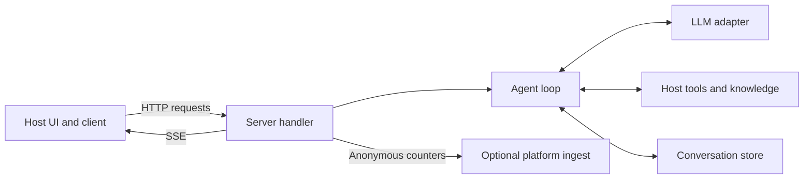

# Architecture

A browser opens a session lazily. The server resolves the host user, creates the store record and signs a token containing the session ID, user ID and expiry. Subsequent requests carry that token and the host's authentication. Replicas share a signing secret and store.

For a user turn the handler validates the request, authenticates the session and applies limits. It appends the user event and rebuilds bounded model history from the store. The model can stream text or request tools. The server validates arguments, runs permitted actions and feeds bounded, untrusted results back into the loop. The client updates its transcript and delivers navigation to the host router.

For a write requiring approval, the server saves a pending request and ends the stream. A confirmation starts another request. The handler authenticates again, looks up the pending action, records a resolution with a unique dedupe key and resumes from stored events. An approval can reach a different server replica. The store holds both the replay guard and history.

After the final event, the SDK can send an aggregate snapshot through a transport with a short deadline. The platform persists instance metadata, counters and error-code counts. The developer's audit log stays in the conversation store. [Telemetry reference](docs/reference/telemetry.md)

## Platform reporting

Ingest validates the shared telemetry schema, charges per-instance and global database buckets, and writes aggregate rows transactionally. The server-rendered dashboard authorizes each page and project action. SQL queries summarize the counters over UTC reporting windows. The platform caches public npm and optional GitHub stats separately from SDK measurements. Local PGlite and deployed Postgres use the same schema. [Platform guide](docs/guides/platform.md)

## Package boundaries

Core defines the wire schema and interfaces, with Zod as a peer. Server, testing and adapters consume core. Client bundles the dependency-free errors and utilities and imports protocol types at build time. React depends on client. The demo composes the SDK and supplies UI. The independent platform consumes the telemetry schema. Dev dependencies and tests can compose workspace packages across these boundaries. [Dependency checker](scripts/check-deps-direction.ts)
